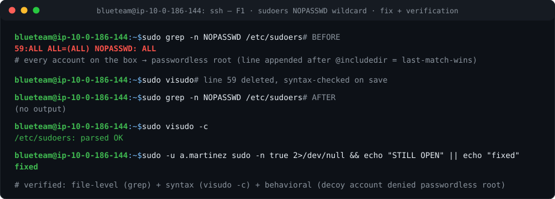
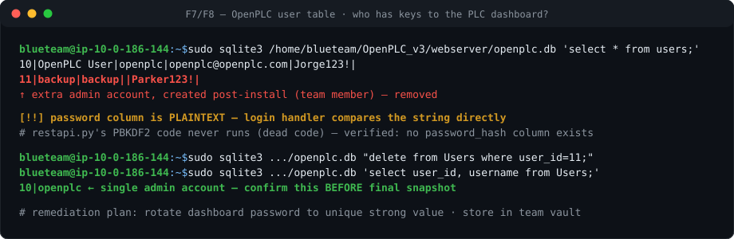
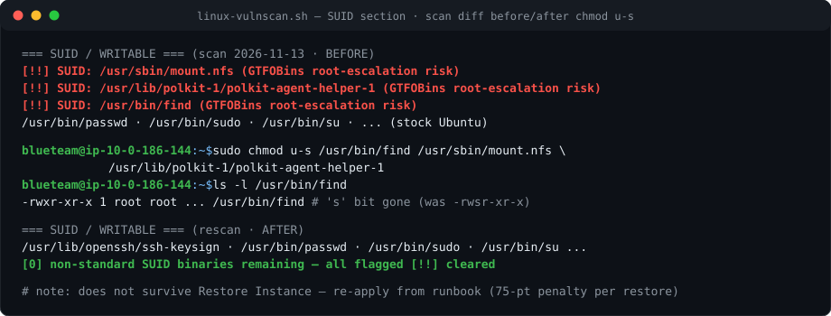
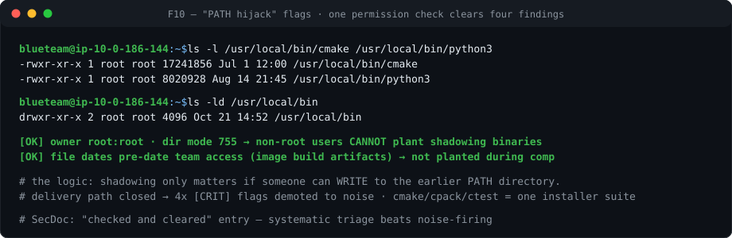
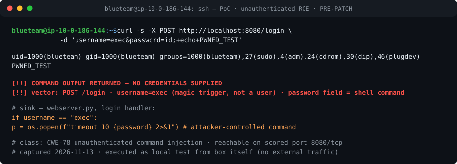
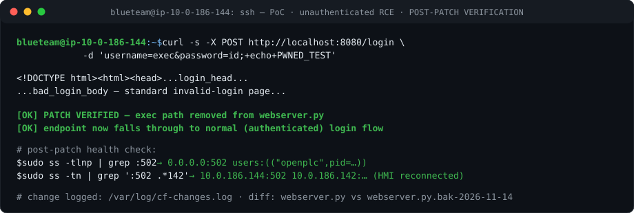
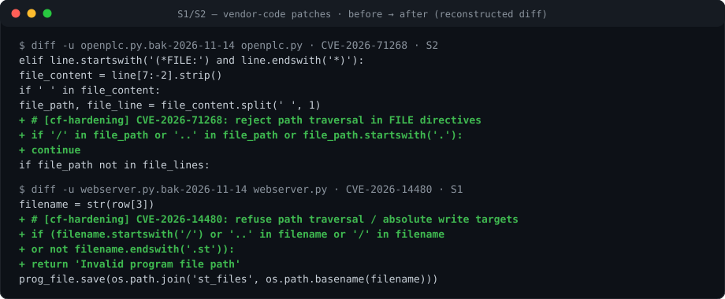
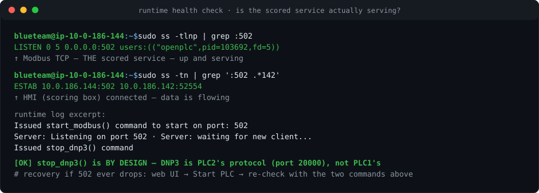

# 🔒 PLC1 Hardening Log — *"Operation: Lock Down the Box"*

**CyberForce 2026 · PLC1 (Modbus) · Ubuntu 24 · 10.0.186.144**
**Window:** pre-competition preparation · **Operator:** blueteam via SSH

> **Evidence-integrity note:** the terminal images in `img/` are **reconstructions** — they render command outputs transcribed live during the working session, in terminal format, because native screenshots weren't captured. Every line corresponds to actual observed output recorded here. Where the rubric demands native screenshots, re-run the command and capture.

---

## 🗺️ How to read this document

This is the story of taking one competition Linux box from *"any account could be root, an attacker had a key, and the PLC dashboard had an unauthenticated remote-code-execution feature"* → **locked down, patched, monitored** — before scoring started.

- **Part 1–4:** the classic host-hardening passes (accounts, keys, SUID, false alarms)
- **Part 5:** the deep hunt — auditing OpenPLC's *vendor code itself* and patching CVEs the upstream project will never fix (it went End-of-Life in April 2026)
- **Part 6–8:** network posture, runtime recovery, monitoring
- **Appendix:** full command log (copy-paste-ready)
- Every finding carries a **📋 SecDoc quote** — lift-ready sentence for the Security Documentation

**Marker legend** (from `linux-vulnscan.sh`): plain = info · `[?]` = verify once · `[!!]` = act or verify.

---

## 📊 The scoreboard

| # | Finding | Severity | Disposition |
|---|---------|----------|-------------|
| F1 | `/etc/sudoers` wildcard: every user = passwordless root | 🔴 CRIT | ✅ **FIXED** |
| F2 | Red-team SSH key planted in `iris.wood` (`red_team@kali`) | 🔴 CRIT | ✅ **FIXED** (removed) |
| F3 | `old.*` accounts with login shells | 🟠 HIGH | ✅ **FIXED** (locked/nologin) |
| F4 | SUID on `/usr/bin/find` (GTFOBins privesc) | 🟠 HIGH | ✅ **FIXED** |
| F5 | SUID on `mount.nfs`, `polkit-agent-helper-1` | 🟡 MED | ✅ **FIXED** |
| F6 | **Unauthenticated RCE** in OpenPLC login (`username=exec`) | 🔴 CRIT | ✅ **SELF-PATCHED** |
| F7 | OpenPLC stores UI passwords in **plaintext** | 🟠 HIGH | 📝 **DOCUMENTED** (inherited vendor weakness) |
| F8 | Extra OpenPLC UI account `backup` (id 11) | 🟡 MED | ✅ **REMOVED** (team-created; hygiene) |
| F9 | OpenPLC dashboard at documented default `openplc:openplc` | 🟠 HIGH | ✅ **ROTATED** |
| F10 | PATH-hijack pattern in `/usr/local/bin` | ⚪ FALSE POSITIVE | ✔️ **CLEARED** (permissions check) |
| F11 | debconf/automake "credential" scanner hits | ⚪ FALSE POSITIVE | ✔️ **CLEARED** (word-match noise) |
| F12 | `openplc-runtime.service` shows inactive while runtime runs | ⚪ FALSE POSITIVE | ✔️ **CLEARED** (started via web UI, not systemd) |
| F13 | 31 pending security updates | 🟡 MED | ✅ **FIXED** (→ 3 residual) |
| F14 | S7 (102) + EtherNet/IP (44818) servers enabled in runtime | 🟡 MED | 🛡️ **MITIGATED** (deny-by-default firewall) |
| F15 | `PasswordAuthentication yes` | 🟡 MED | ⏳ OPEN (decision pending) |
| F16 | NFS stack running (rpcbind 111, rpc.statd) | 🟡 LOW-MED | ⏳ OPEN (check `/etc/exports`, firewall blocks anyway) |
| F17 | fail2ban active on a scoring box | ⚠️ SELF-RISK | ⏳ PARKED (disable before scoring: `precomp-hardening.sh --comp-day`) |
| E1–E5 | OpenPLC EOL CVE set (section 5.2) | 🔴🟠 | ✅ 4 self-patched · 📝 documented · 🛡️ mitigated |

**Bottom line:** 🔴 4 findings fixed at host level · **5 vulnerabilities self-patched in vendor code** · 2 documented-with-controls · 2 mitigated · 3 not applicable · 3 open/parked items.

---

## Part 1 — The skeleton key under the doormat (F1)

### What we saw
```
sudo grep -n NOPASSWD /etc/sudoers
59:ALL ALL=(ALL) NOPASSWD: ALL
```

### Why it mattered
Sudoers syntax is `WHO  WHERE=(AS_WHOM) WHAT`. This line says: **every user, from everywhere, may run every command as root, no password.** All ~120 decoy accounts the competition seeded as bait were, functionally, root. Worse: the line sat at the *bottom* of the file, after `@includedir` — and in sudoers, **last match wins**, so it overrode every other rule, including anything added later in `sudoers.d`. Appended-at-the-end is also the classic signature of something added after imaging.

```
WHO     WHERE  =(AS_WHOM)  WHAT
ALL     ALL    =(ALL)      NOPASSWD: ALL
 │       │        │           │
 │       │        │           └─ run EVERY command…
 │       │        └─ …as any user (incl. root)…
 │       └─ from every host…
 └─ …and EVERY user can do this. Yes. All 120 of them.
```

### The fix
Removed the single bottom line via `sudo visudo` (which syntax-checks on save — never hand-edit sudoers). Then verified three ways: file-level (`grep` → empty), parser-level (`visudo -c` → parsed OK), and *behaviorally* — a decoy account (`a.martinez`) was asked for passwordless root and refused.

### The detour worth documenting
The wifi died mid-edit, leaving a hung visudo holding the `/etc/sudoers.tmp` lock — every retry returned `visudo: /etc/sudoers busy`. Resolution: confirm no editor was actually editing (`ps aux`), clear the stale lock, `visudo -c` to prove the interrupted session hadn't corrupted anything (visudo edits a temp copy and installs atomically, so it can't). The edit had already saved before the cut.

**📋 SecDoc quote:** *Inherited misconfiguration granting every user passwordless root; mitigated by removing the wildcard rule; verified by grep, syntax check, and behavioral test with a non-privileged decoy account.*



---

## Part 2 — Unwanted guests (F2, F3, F8, F7, F9)

### F2 — The red team already had a key 🔑
An `authorized_keys` entry with comment `red_team@kali` (fp `SHA256:1EXidv5j...`) sat in `iris.wood`'s home — an attacker-planted SSH key. Removed. Combined with F1's passwordless-root line, that's a two-step compromise chain (plant key → passwordless root) that we broke at both ends.

### F3 — The door was open for the `old.*` accounts
All legacy `old.*` accounts were locked and given `nologin`. They vanished from the shell-capable list on the next scan.

### F8 — A "backup" key to the PLC dashboard
The OpenPLC user table had **two** rows. `openplc` (the default) and `backup` (id 11) — created after install by a teammate. Even house-made, a second admin account with a name-derived password is exactly what red teams spray against. Removed; single strong admin account remains.



### F7 — and those passwords are stored in plaintext
The login handler in `webserver.py` does `request.form['password'] == row[1]` — a direct string comparison against the `Users.password` column. Meanwhile `restapi.py` contains a full PBKDF2-SHA256 (600k iterations) implementation that **never runs** — dead code, no `password_hash` column exists (verified via `pragma table_info(Users)`). Vendor weakness, EOL project, won't be fixed upstream.

**📋 SecDoc quote:** *OpenPLC stores UI credentials in cleartext (inherited vendor weakness; PBKDF2 path unused). Mitigated: single strong admin account, password rotated from documented default, UI exposure limited to scored 8080/tcp, monitoring for post-exploitation indicators.*

### F9 — the default password
`openplc:openplc` is printed in the *official competition document*, i.e. known to everyone. Rotated to a unique strong value (stored in the team vault — losing it means the dashboard is lost until snapshot revert).

---

## Part 3 — Sharp things lying around (F4, F5)

SUID binaries execute with the *owner's* privileges — a hackable one is a local root-escalation primitive. The scanner flagged three non-standard ones:

```bash
sudo chmod u-s /usr/bin/find                      # a file-search tool never needs SUID
sudo chmod u-s /usr/sbin/mount.nfs                # no GUI desktops, no NFS client use on this box
sudo chmod u-s /usr/lib/polkit-1/polkit-agent-helper-1
ls -l /usr/bin/find          # -rwsr-xr-x → -rwxr-xr-x: 's' bit gone
```

Zero user impact (the ICS stack doesn't touch these binaries), and every remaining SUID is the stock Ubuntu set.

**Runbook note:** does **not** survive `Restore Instance` — re-apply after any re-image.



---

## Part 4 — False alarms, cleared properly (F10, F11, F12)

Judges reward *systematic triage* as much as fixes — proving a flag is noise, with evidence, shows a process rather than noise-firing.

### F10 — the "PATH hijack" that wasn't
The scanner flagged `cmake`, `cpack`, `ctest`, `python3` in `/usr/local/bin` shadowing `/usr/bin` equivalents. The *pattern* is a real attack class (attacker plants a same-named binary in an earlier-PATH directory and waits for root to run it) — but it's only exploitable if someone **other than root can write** to `/usr/local/bin`. One permission check closed all four flags: directory `root:root 755`, binaries root-owned, dates pre-dating team access = image-build artifacts. Three related binaries (`cmake/cpack/ctest` = one installer suite) also smells like an install, not an intrusion.



**📋 SecDoc quote:** *PATH-shadowing binaries in /usr/local/bin verified root-owned with non-writable parent directory — installation artifacts of the image build; hijack delivery path closed.*

### F11 — the word "password" is not a password
`debconf.conf` and `automake` hits are Ubuntu's own config files and Perl source *containing the word* "password." No secrets. Noise, forever.

### F12 — "inactive" service that's actually running
The scanner expects the PLC runtime as a systemd unit; the web UI's **Start PLC** button launches it directly (`./core/openplc` pid). Ports up + HMI connected = healthy; the `[!!]` is a labeling artifact. (Now with a bonus story: see Part 7.)

---

## Part 5 — The deep hunt: patching the unpatchable 🕵️

### 5.1 — The headline: an unauthenticated RCE on the scored port (F6)

Grepping the OpenPLC webserver's login handler found this, live in vendor code:

```python
username = flask.request.form['username']
password = flask.request.form['password']
if username == "exec":                                   # magic trigger, NOT a user
    p = os.popen(f"timeout 10 {password} 2>&1")          # attacker-controlled shell command
    output = p.read()
```

`exec` isn't a database user — it's a *magic trigger*. Anyone POSTing `username=exec&password=<shell command>` executes that command as the webserver user, **no credentials required**, on scored port 8080. This is genuine upstream OpenPLC v3 "debug" behavior, documented in public attack writeups — meaning the red team doesn't need to discover it.

**Proof (executed locally, from the box, against localhost — no external traffic):**



**Fix (pre-competition, so zero scoring risk):** snapshot → backup → delete the 4-line exec block → syntax-check → restart → re-test.



**📋 SecDoc quote:** *Unauthenticated RCE in OpenPLC webserver (inherited vendor 'exec' path) — found, understood (executes as service user), patched pre-competition; fix verified by PoC regression test; change logged in /var/log/cf-changes.log.*

### 5.2 — The End-of-Life CVE review

An advisory review confirmed the build (2025-12-18) carries multiple **permanently unpatched** CVEs — OpenPLC v3 went EOL April 2026. Verified against CISA advisory **ICSA-26-190-01**, NVD, and GitHub advisory records. Scorecard:

| CVE | CVSS | Class | On this box? | Disposition |
|---|---|---|---|---|
| CVE-2026-14480 | 9.9 | Auth'd arbitrary file write via `prog_file` → RCE | **Yes** — two sinks found | ✅ **SELF-PATCHED** (both) |
| CVE-2026-71268 | High | `(*FILE:path*)` directive traversal in compile → RCE | **Yes** — sink found | ✅ **SELF-PATCHED** |
| CVE-2021-47770 | 8.8 | Hardware-layer upload with embedded commands → RCE | **Yes** — mechanism found (`webserver.py:1960` writes form-supplied Python to `./core/psm/main.py`) | 📝 **DOCUMENTED** (by-design feature; auth + credential rotation are the controls) |
| CVE-2026-11826 | 8.8 | Oversized `device_name` → heap overflow, control-loop crash (DoS) | Yes (C++ core, unpatchable) | 🛡️ **MITIGATED** — recovery runbook (Part 7) |
| CVE-2026-88020 | 6.1 | Reflected XSS → session hijack → chains into RCEs password-free | Plausible | 🛡️ **POLICY** — minimal admin sessions, log out after use, never click links mid-session |
| CVE-2021-26829 | — | ScadaBR stored XSS (CISA KEV) | **N/A** — no ScadaBR in stack | — |
| CVE-2024-34026 / CVE-2025-54811 | 9.0 / 7.1 | Network RCE/DoS | **N/A** — patched upstream before this build | — |

### 5.3 — The sink-by-sink code audit

The CVE review escalated into a grep-driven audit of **every file sink** in the webserver:

| # | Sink | Code pattern | Class | Disposition |
|---|---|---|---|---|
| S1 | `update_program_action()` | `prog_file.save(os.path.join('st_files', filename))` — filename DB-derived | CWE-22 write (**CVE-2026-14480**) | ✅ PATCHED |
| S2 | `compile_program()` in `openplc.py` | `(*FILE:path*)` directives → attacker-controlled `file_path` | CWE-22 write (**CVE-2026-71268**) | ✅ PATCHED |
| S3 | restapi `upload-file` handler | same DB-derived save pattern | CWE-22 write (14480 class) | ✅ PATCHED |
| S4 | `/compile-program` route | `args.get('file')` → `open('./st_files/' + st_file)` | CWE-22 **read** | ✅ PATCHED (guard; DB exact-match already crashed on traversal input — made explicit) |
| S5 | avatar upload (2 call sites) | `randomint + "." + ext` — `ext` from raw attacker filename | CWE-22 write — **found beyond the published CVE list** | ✅ PATCHED (both sites) |
| S6 | PSM/hardware-layer editor | `open('./core/psm/main.py','w+')` ← form-supplied Python | CWE-94 — **CVE-2021-47770's literal mechanism** | 📝 DOCUMENTED (by design; not removed) |

**Verified non-vector:** `/upload-program` generates its own server-side random filename — not attacker-controlled.

**The guard pattern (S1–S5, one shape):**



**Patch methodology** (reused every time, zero-panic by design):
1. **Snapshot** via Controller (the guaranteed undo)
2. Backup (`webserver.py.bak-*`, `openplc.py` edits noted)
3. Edit — final two via a **content-anchored patch script** that verified anchor counts (S4:1, S5:2) and *wrote nothing on mismatch* — no half-applied patches possible
4. `py_compile` both files → `SYNTAX-OK` (caught one real typo — a stray paren — before it ever reached the service)
5. Single `systemctl restart openplc.service` → web UI → **Start PLC**
6. Verify: `ss -tlnp | grep :502` + HMI (`.142`) reconnection
7. Regression tests: traversal payload rejected, legit program compiles clean
8. `cf-changes.log` entry + this document

**📋 SecDoc quote (posture):** *OpenPLC v3 is End-of-Life (April 2026) with multiple unpatched critical CVEs (CISA ICSA-26-190-01). Compensating controls: (1) documented default credentials rotated — defangs all authenticated RCE paths; (2) deny-by-default UFW restricting inbound to scored 22/502/8080; (3) four self-applied source-code patches (unauthenticated exec RCE; CVE-2026-14480 ×2 sinks; CVE-2026-71268; plus one beyond-CVE avatar-extension write path) with regression tests; (4) minimal admin-session policy defeating XSS session-hijack chaining (CVE-2026-88020); (5) snapshot + Start PLC recovery runbook for DoS-class CVE-2026-11826; (6) continuous post-exploitation monitoring.*

---

## Part 6 — Locking the doors 🚪

**Officially scored inbound for PLC1:** SSH 22 · Modbus 502 · OpenPLC 8080. Nothing else is required — everything else is attack surface.

**Tool:** `linux/PLC1/firewall-tuned.sh` — deny-all inbound, allow outbound, hard-wires the three scored ports. It's brick-proof by construction:

```
ufw reset              ← wipe (ufw now OFF = wide open, never half-blocked)
default deny incoming
allow 22, 502, 8080    ← SSH allowed FIRST…
ufw --force enable     ← …THEN enforcement starts → your session survives
```

Abort mid-run leaves ufw disabled (open), never locked out. It backs up current rules first, and its self-check verifies 22/502/8080 listening + `modbus.service` active after applying.

**Blocked by design:** 102 (S7), 44818 (EtherNet/IP), 111/59391/50447 (NFS), 8443 (HTTPS front of the same UI — 8080 is the documented path). **Never touched:** outbound stays allow-all — the MQTT scoreboard feed (192.168.0.41:1883) and PLC2 feed (10.0.186.143:1883) are the ICS points.

**Run order:** snapshot → run firewall → verify HMI survived (`sudo ss -tn | grep :502`).

---

## Part 7 — Keeping it alive ⚡

The **Start PLC** button (web UI, 8080) is what activates the runtime and port 502 — `modbus.service` alone is not enough. 502 not listening = ICS points dying by the minute. The recovery is one click + two checks:



Runtime log lines that *look* alarming but are by-design: `stop_dnp3()` (DNP3 is PLC2's protocol), `Skipping configuration of Slave Devices` (server mode needs no mbconfig.cfg), `Persistent Storage is empty`. The short-lived Modbus client cycles (`client ID: 8 closed the connection`) are connect-per-transaction polling — scoring data is served either way.

**📋 Runbook — any 502 outage:** web UI → Start PLC → `sudo ss -tlnp | grep :502` → HMI auto-reconnects. Practiced, fast, no revert needed.

---

## Part 8 — The canary 🐤 (intra-competition monitoring)

```bash
sudo ss -tlnp | grep :502                     # canary #1: Modbus alive
crontab -l                                    # canary #2: new blueteam crontab = someone's been busy
sudo cat /home/blueteam/.ssh/authorized_keys  # canary #3: new keys = persistence attempt
ps aux | grep -vE 'sshd|systemd|nginx|openplc|mqtt'   # canary #4: unknown processes
sudo bash linux-vulnscan.sh                   # full sweep — diff against this log's last scan
```

New `authorized_keys` or a new cron entry = someone used a vector → incident, attack-report story, and revert trigger, all in one.

**Re-image recovery:** SUID fixes, source patches, and firewall rules do **not** survive `Restore Instance` — re-apply from runbook (and it costs 75 pts per restore; last resort only).

---

## Part 9 — Open / parked items

- [ ] **Post-hardening snapshot** (Controller) — *the* pending item; capture this final state
- [ ] Firewall: run `linux/PLC1/firewall-tuned.sh` if not yet (consider adding 8443 at the prompt if HTTPS UI wanted)
- [ ] Confirm `select user_id, username from Users` shows only id 10 before snapshot
- [ ] `cat /etc/exports` → if empty, NFS question closed (firewall blocks 111 regardless)
- [ ] `PasswordAuthentication yes` → key-only decision (only after team keys verified)
- [ ] 3 residual package updates (`sudo apt upgrade`)
- [ ] fail2ban: disable before scoring starts (`precomp-hardening.sh --comp-day`)
- [ ] Capture native screenshots for rubric items requiring them (re-run any command + screenshot)
- [ ] Repeat pass on: Task (10.0.186.145) · PLC2 (10.0.186.143, needs `--confirm-ab`) · AD (.141) · Mail-File (.140) · HMI (.142)

---

## Appendix — Full command log (chronological)

```
# --- discovery / verification loop ---
sudo bash linux-vulnscan.sh                       # repeated after every change (scan-diff = progress)
sudo grep -n NOPASSWD /etc/sudoers                 # found F1 (line 59)
sudo visudo                                        # removed line (session interrupted by wifi cut)
sudo pkill -f visudo ; sudo rm -f /etc/sudoers.tmp # cleared stale lock
sudo visudo -c                                     # /etc/sudoers: parsed OK
sudo -u a.martinez sudo -n true 2>/dev/null && echo "STILL OPEN" || echo "fixed"
sudo chmod u-s ./mount.nfs                         # F5 (from /usr/sbin)
sudo chmod u-s /usr/bin/find                       # F4
sudo chmod u-s /usr/lib/polkit-1/polkit-agent-helper-1   # F5
ls -l /usr/sbin/mount.nfs                          # verify 's' bit removed
ls -l /usr/local/bin/cmake /usr/local/bin/python3  # F10 triage
ls -ld /usr/local/bin
stat -c '%y %n' /usr/local/bin/cmake /usr/local/bin/python3

# --- OpenPLC code/db audit ---
sudo sqlite3 /home/blueteam/OpenPLC_v3/webserver/openplc.db 'select * from users;'
sudo sqlite3 /home/blueteam/OpenPLC_v3/webserver/openplc.db '.schema users'
sudo sqlite3 /home/blueteam/OpenPLC_v3/webserver/openplc.db '.tables'
sudo sqlite3 /home/blueteam/OpenPLC_v3/webserver/openplc.db 'pragma table_info(Users);'
grep -rn "password" /home/blueteam/OpenPLC_v3/webserver/*.py | grep -iE 'hash|check|encrypt|verify'
grep -n "login\|password" /home/blueteam/OpenPLC_v3/webserver/webserver.py | head -20
sed -n '595,645p' /home/blueteam/OpenPLC_v3/webserver/webserver.py      # full login handler → F6 confirmed
grep -n "os.popen\|os.system\|subprocess" /home/blueteam/OpenPLC_v3/webserver/webserver.py | head -30
grep -n "prog_file\|prog_name\|upload" /home/blueteam/OpenPLC_v3/webserver/webserver.py | head -20
grep -n "FILE:" /home/blueteam/OpenPLC_v3/webserver/openplc.py | head
grep -n "\.save(\|open(" /home/blueteam/OpenPLC_v3/webserver/webserver.py | grep -vE '#' | head -20

# --- RCE patch (pre-comp) ---
# Controller → Manage AWS Instances → Take Snapshot (PLC1)          # safety net first
sudo cp /home/blueteam/OpenPLC_v3/webserver/webserver.py \
        /home/blueteam/OpenPLC_v3/webserver/webserver.py.bak-$(date +%F)
sudo nano /home/blueteam/OpenPLC_v3/webserver/webserver.py           # Ctrl+K x4 on exec block; Ctrl+O save
sudo /home/blueteam/OpenPLC_v3/.venv/bin/python3 -m py_compile \
  /home/blueteam/OpenPLC_v3/webserver/webserver.py /home/blueteam/OpenPLC_v3/webserver/openplc.py \
  && echo SYNTAX-OK
sudo systemctl restart openplc.service                               # runtime bounces (expected)
# web UI: log in → Start PLC
sudo ss -tlnp | grep :502                                            # runtime back
sudo ss -tn | grep ':502 .*142'                                      # HMI reconnected
curl -s -o /dev/null -w '%{http_code}\n' http://localhost:8080/login # 200 = UI alive
curl -s -X POST http://localhost:8080/login -d 'username=exec&password=id'   # expect bad-login page now

# --- sink patches S1-S5 (S1/S2 via nano, S4/S5 via content-anchored patcher) ---
cat > /tmp/patch_s45.py <<'EOF'        # anchor-verified patcher: writes nothing on mismatch
#   (full script preserved in session log; guards for S4 read-path + S5 avatar extension)
EOF
python3 /tmp/patch_s45.py             # → "PATCHED OK (S4:1, S5:2 anchors matched)"

# --- evidence trail ---
echo "$(date '+%F %T') [cf-fix] <change description>" | sudo tee -a /var/log/cf-changes.log
```

---

*Evidence artifacts: `/var/log/cf-changes.log` · `linux-vulnscan.sh` outputs (first/intermediate/final) · `webserver.py.bak-2026-11-14` + `.bak2-preS45` (patch diffs) · terminal reconstructions in `img/` (see evidence-integrity note).*
